# xva-counterparty-credit

**A Monte Carlo engine for counterparty exposure and XVA (CVA, DVA, FVA), with netting, CSA collateral and wrong-way risk.**

[](https://github.com/crollila/xva-counterparty-credit/actions/workflows/ci.yml)


> [!IMPORTANT]
> **The portfolio is simulated and the XVA method is simplified.** Every trade, notional, curve, volatility and
> CDS spread in this repository is made up for illustration. All amounts are in a made-up currency called
> "DOM". The methods are the textbook versions used for teaching and research. This is **not** a
> production XVA system, its numbers are not prices, and it does not claim production accuracy. The full
> list of simplifications is in [MODEL_ASSUMPTIONS.md](MODEL_ASSUMPTIONS.md).

---

## Contents

1. [The one-paragraph version](#the-one-paragraph-version)
2. [Quick start](#quick-start)
3. [Counterparty risk for newcomers](#part-1--counterparty-risk-for-newcomers)
4. [How the engine works, step by step](#part-2--how-the-engine-works-step-by-step)
5. [Results on the simulated portfolio](#part-3--results-on-the-simulated-portfolio)
6. [How it is validated](#part-4--how-the-engine-is-validated)
7. [Repository layout](#repository-layout)
8. [Glossary](#glossary)

---

## The one-paragraph version

When a bank trades a derivative such as an interest-rate swap with a client, the trade can end up owing the bank
money. If the client goes bust at that point, the bank loses some of it. This project measures that risk.
It simulates 20,000 possible futures for interest rates and an FX rate, re-prices a small **simulated** portfolio
(4 swaps and 2 FX forwards) on every future path and date, and works out how much the client could owe us
(**exposure**). It then turns exposure into a price for the client's default risk (**CVA**), our own default risk
(**DVA**) and the cost of funding the trades (**FVA**). It also measures how far **netting** and **collateral**
reduce the risk, and what happens when the client is most likely to default exactly when it owes us the most
(**wrong-way risk**).

On the base run, netting cuts CVA by <!--v:reductions_vs_gross.netted.CVA_pct|pct-->22.5<!--/v-->% and
netting + collateral cuts it by <!--v:reductions_vs_gross.netted_collateralised.CVA_pct|pct-->79.6<!--/v-->%
(from <!--v:regimes.gross.CVA.value|k-->657.7<!--/v-->k to <!--v:regimes.netted_collateralised.CVA.value|k-->134.1<!--/v-->k DOM).
Moderate wrong-way risk (beta = 0.5) multiplies the uncollateralised CVA by
<!--v:d.wwr_netted_b+0p50_ratio|x-->1.54<!--/v-->x.

## Quick start

```bash
pip install -r requirements.txt
```

```bash
python run_all.py
```

That one command runs the test suite, the full experiment (about 4 minutes on a laptop), all 13 figures, writes
every number into this README and [ANALYSIS.md](ANALYSIS.md), and then checks that the docs match
`results/summary.json`. Other entry points:

```bash
python run_all.py --quick
```

```bash
python -m pytest
```

```bash
python -m xva.report --check
```

(`--quick` uses small path counts and writes to scratch folders. The last two need `src` on the path,
e.g. `pip install -e .` first.)

---

## Part 1 - Counterparty risk for newcomers

### The basic problem

A **derivative** is a contract whose value depends on something else, such as an interest rate or an exchange rate.
Take an **interest-rate swap**. We agree to pay a client a fixed 3.7% a year on 100 million, and the client pays
us whatever the floating market rate turns out to be. If rates go up, the floating payments we receive grow, so
the contract becomes worth more to us. In effect the client now owes us money.


If the client **defaults** at that moment, we lose most of what it owes. That is **counterparty credit risk**.
Three things make it hard to measure:

1. **We don't know what the contract will be worth in the future.** Today it may be worth almost nothing, but it
   could be worth a lot to us, or a lot to the client, in 3 years. So we need the whole *distribution* of
   future values, which is why we use Monte Carlo simulation.
2. **We don't know when the client will default.** We model default as a random event with a probability that
   comes from the client's credit spread.
3. **Legal agreements change the loss.** *Netting* lets trades with the same client offset each other.
   *Collateral* (cash the client posts as security) covers most of what is owed.

### What the engine produces

| Question | Measure | Plain-English meaning |
|---|---|---|
| How much could the client owe us on average at time *t*? | **EE(t)**, expected exposure | Average of the positive future values |
| How much in a bad scenario? | **PFE(t)**, potential future exposure | 95th or 99th percentile of the positive future values |
| One number for average exposure over the life? | **EPE** | Time-average of EE |
| What is the client's default risk worth? | **CVA** | Expected loss from the client defaulting, today's money |
| What is our own default risk worth to the client? | **DVA** | The mirror image of CVA, a "benefit" on our books |
| What does it cost to fund the uncollateralised position? | **FVA** | Funding spread x expected funding need |

---

## Part 2 - How the engine works, step by step

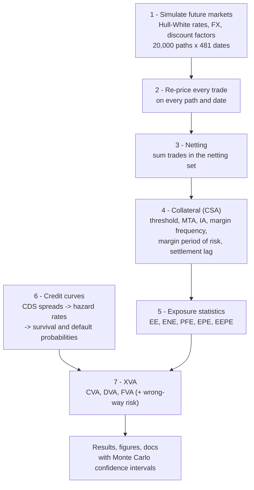

The code for each step is in [`src/xva/`](src/xva): `simulation.py` (1), `instruments.py` (2),
`exposure.py` (3, 5), `collateral.py` (4), `credit.py` (6), `xva.py` and `wwr.py` (7).

### Step 1 - Simulate future markets

The engine draws thousands of random but internally consistent future paths for:

* **Interest rates**, from the one-factor **Hull-White** model. The short rate is $r(t) = x(t) + \varphi(t)$, where
  $dx = -a\,x\,dt + \sigma\,dW$ is a random process that drifts back towards zero, and $\varphi(t)$ is chosen so the
  model reproduces today's yield curve exactly. Its main convenience is that the price of any future zero-coupon
  bond $P(t,T)$ has a closed-form formula in $x(t)$. That makes re-pricing swaps on 20,000 paths fast.
* **The discount factor** $D(0,t) = e^{-\int_0^t r(s)ds}$. It converts money at time *t* into money today. It is
  simulated *exactly* together with $x(t)$, without the usual small-step approximation.
* **The FX rate** $S(t)$, which is lognormal and drifts at the domestic rate minus the foreign rate. Its shocks are
  correlated with the rate shocks.

Time runs on a grid of 48 steps per year (about 1.1 weeks per step) for 10 years, so 481 dates. Every swap
payment date falls exactly on the grid. The random seed is fixed, so every run gives the same numbers.

**Variance reduction:** with **antithetic variates**, every random path is paired with its mirror image (all
shocks flipped in sign). Errors on the two halves partly cancel. On this portfolio that cuts the variance of the
CVA estimate by about <!--v:variance_reduction.CVA_variance_ratio_plain_over_antithetic|x-->4.02<!--/v-->x for
the same number of paths.

### Step 2 - Re-price every trade on every path

At every future date the engine values each trade from the simulated market. The value is from **our** side:
a positive number means the client owes us.

* **Swap:** value of the floating leg minus value of the fixed leg (or the reverse for a receiver). Both legs are
  sums of simulated bond prices. Floating coupons are fixed on the path when they reset.
* **FX forward:** $N\,(S(t)\,P_f(t,T) - K\,P_d(t,T))$, the value today of buying $N$ units of foreign currency
  at the agreed rate $K$.

The grey lines below are 40 of the 20,000 simulated futures for the whole portfolio. Every statistic in this
project is computed from this cloud of paths.

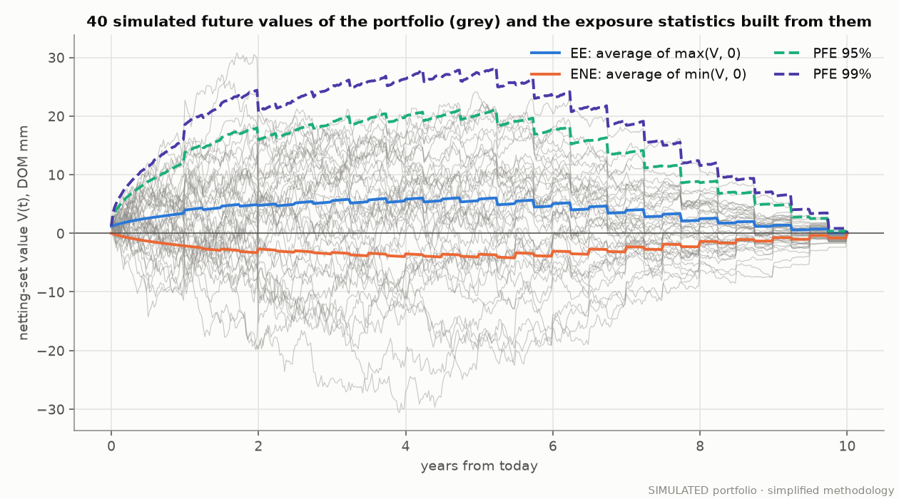

The saw-tooth steps come from swap coupons being paid. Once a cashflow is paid it no longer counts in the
remaining value, so the value drops.

### Step 3 - From values to exposure

We only lose money if the client defaults **while it owes us**, so the key quantity is the positive part of the
value:

| Symbol | Definition | Meaning |
|---|---|---|
| $PE(t) = \max(V(t), 0)$ | positive exposure | what we lose if the client defaults now (before recovery) |
| $NE(t) = \min(V(t), 0)$ | negative exposure | what the client loses if **we** default now |
| $EE(t) = \mathbb{E}[PE(t)]$ | expected exposure | average over all paths |
| $ENE(t) = \mathbb{E}[NE(t)]$ | expected negative exposure | used for DVA |
| $PFE_q(t)$ | potential future exposure | the *q*-quantile of $PE(t)$ (here 90 / 95 / 97.5 / 99%) |
| $EPE = \frac{1}{T}\int_0^T EE(t)\,dt$ | expected positive exposure | one-number summary |
| EEPE | effective EPE (Basel) | first-year average of the running maximum of EE |

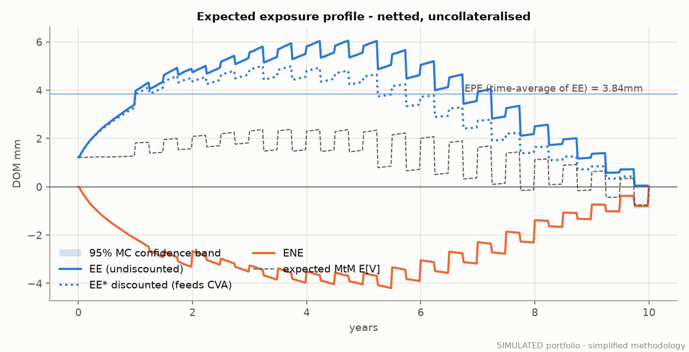

The shaded band is the 95% Monte Carlo confidence interval for EE. It is narrow, so 20,000 paths is plenty for
EE. Tail measures like PFE 99% are noisier, so their confidence intervals come from a bootstrap that resamples
antithetic pairs together.

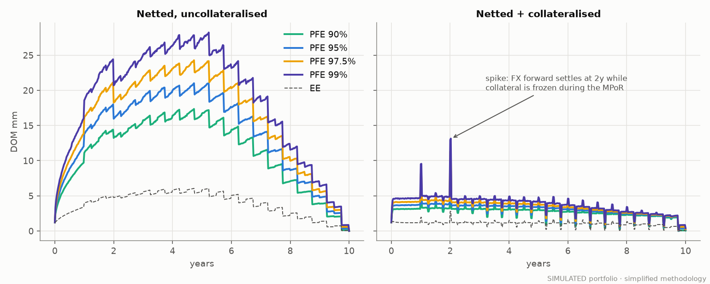

### Step 4 - Netting

Under a netting agreement, if the client defaults, all trades with it are settled as **one net amount**.
Suppose we are owed +10 on trade A and owe -7 on trade B:

| | Without netting | With netting |
|---|---|---|
| Our claim | we lose 10 on A, and must still pay the 7 on B | we lose only 10 - 7 = **3** |
| Exposure | $\sum_i \max(V_i, 0) = 10$ | $\max(\sum_i V_i, 0) = 3$ |

The engine computes both. Netting can only lower positive exposure, and that is tested on every path. The stacked
areas below are each trade's stand-alone EE. The black line is the EE of the netted portfolio. The gap between
them is the netting benefit. It is largest early on, when the pay-fixed and receive-fixed swaps and the two FX
forwards offset each other.

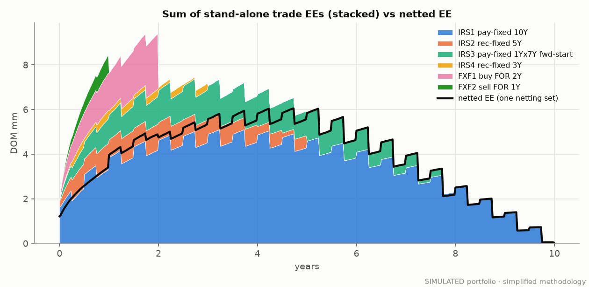

### Step 5 - Collateral (the CSA)

A **Credit Support Annex (CSA)** is the part of the legal agreement that says the party who is owed money receives
collateral. Its terms are the engine's inputs:

| CSA term | What it does | Base case |
|---|---|---|
| **Threshold (TH)** | exposure the client is allowed before it must post anything | 2mm each way |
| **Minimum transfer amount (MTA)** | ignore calls smaller than this | 0.25mm |
| **Independent amount (IA)** | extra collateral held regardless of MtM (simple initial margin) | 0 (variant: 5mm) |
| **Margin frequency** | how often collateral is recalculated | every step (~weekly) |
| **Margin period of risk (MPoR)** | time from the client's last successful posting to closing out after default | 2 steps (~10.5 business days) |
| **Settlement lag** | delay between a call and the cash arriving | 0 (swept 0-2 steps) |

The required balance on a call date is $C_{req} = \max(V - TH_{cpty}, 0) - \max(-V - TH_{own}, 0)$. It moves only
if the change is at least the MTA. **The key idea is the MPoR.** When the client defaults it stops posting, but we
need time to notice, dispute and close out. So the collateral we actually hold at close-out is the amount from
one MPoR ago, $C(t - \text{MPoR})$, and the remaining exposure is

$$PE_{coll}(t) = \max\big(V(t) - C(t-\text{MPoR}) - IA,\ 0\big).$$

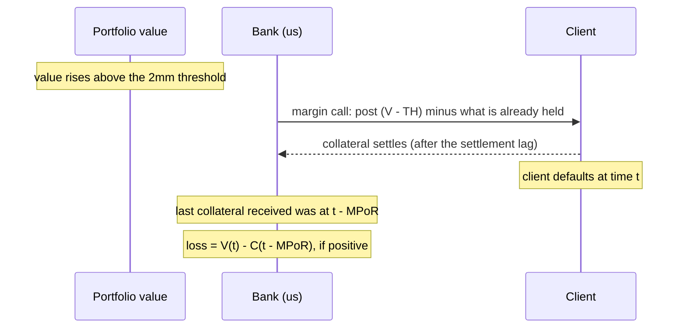

The figure follows one simulated path. Collateral (yellow) tracks the portfolio value (blue). The collateral we
can count on at default (purple, dashed) lags it by the MPoR. The red shaded gap is the remaining exposure: the
threshold plus whatever the value moved during the MPoR.

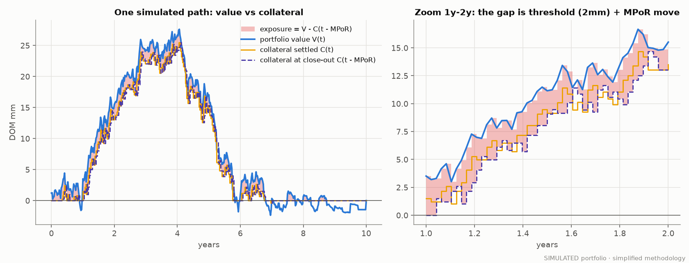

All four combinations of netting and collateral side by side:

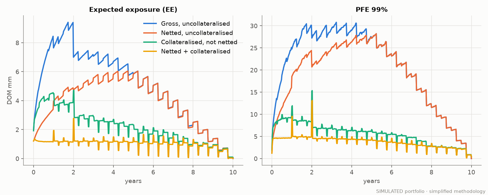

> **Why the spikes in collateralised PFE?** At 1y and 2y an FX forward settles. Its value drops out of the
> portfolio immediately, but the collateral that was backing it is frozen by the MPoR lag. For a short while the
> collateral and the value don't match. This is a known feature of MPoR-based models. Real-world desks handle it
> with more detailed "trade flow during MPoR" assumptions (see [MODEL_ASSUMPTIONS.md](MODEL_ASSUMPTIONS.md)).

### Step 6 - Credit: how likely is default?

Default is modelled as the first jump of a random clock that ticks at a **hazard rate** $\lambda(t)$ (default
intensity per year). Then:

* survival probability: $S(t) = e^{-\int_0^t \lambda(u)du}$
* probability of defaulting between $t_{k-1}$ and $t_k$: $PD_k = S(t_{k-1}) - S(t_k)$
* **loss given default** $LGD = 1 - \text{recovery}$ (recovery 40%, so LGD = 60%)

The hazard rates come from simulated CDS spreads via the "credit triangle", $\bar\lambda \approx s/(1-R)$,
applied piece by piece between CDS tenors. The client's spreads run from 100bp at 1y to 190bp at 10y. Ours run
from 50 to 90bp.

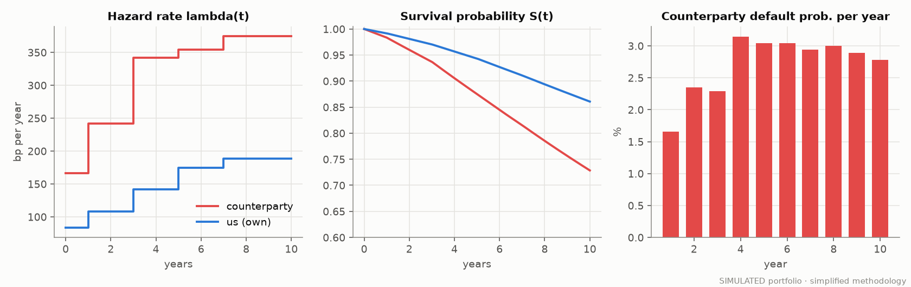

### Step 7 - XVA: putting a price on it

**CVA (credit valuation adjustment)** is the expected loss from the client's default, in today's money:

$$\text{CVA} = LGD_C \sum_k \underbrace{\mathbb{E}\big[D(0,t_k)\,PE(t_k)\big]}_{\text{discounted EE}} \times \underbrace{PD_C(t_{k-1}, t_k)}_{\text{default prob. in bucket}}$$

In words, for each small time bucket: *how much would we lose if they defaulted then* x *how likely is a default
then* x *the fraction we don't recover*, then add up the buckets. This is **unilateral** CVA, because our own
default is ignored. A first-to-default ("bilateral") variant that also weights by our own survival is reported
too.

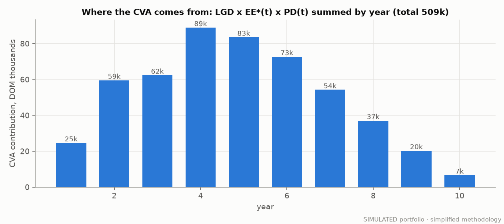

**DVA (debit valuation adjustment)** is the same formula from the client's side. It uses our negative exposure
and **our** default probabilities, and it shows up as a benefit to us:
$\text{DVA} = LGD_B \sum_k \mathbb{E}[D\,|NE(t_k)|]\;PD_B(t_{k-1},t_k)$.

**FVA (funding valuation adjustment)** is a deliberately simple, transparent version. When a trade is in our
favour and uncollateralised, we must borrow to fund it at a spread $s_b$ (cost, **FCA**). When it is against us,
we effectively hold the client's money and earn $s_l$ (benefit, **FBA**):

$$\text{FCA} = \sum_k s_b\,\mathbb{E}[D\,PE(t_k)]\,S_C S_B\,\Delta t_k,\qquad \text{FBA} = \sum_k s_l\,\mathbb{E}[D\,|NE(t_k)|]\,S_C S_B\,\Delta t_k,\qquad \text{FVA} = \text{FCA} - \text{FBA}.$$

Its limitations (overlap with DVA, one flat funding spread, no initial-margin funding (MVA), and others) are spelled
out in [MODEL_ASSUMPTIONS.md](MODEL_ASSUMPTIONS.md#fva).

**Wrong-way risk (WWR).** The formulas above assume default and exposure are independent. With WWR the client
tends to default exactly when it owes us most. The engine models this with a transparent simplified mechanism.
On each path the client's hazard rate is scaled by $e^{\beta Z(t)}$, where $Z$ is the standardised portfolio
value on that path. The scale is re-calibrated at every step so the *average* default probabilities still match
the CDS curve. Any change in CVA therefore comes purely from the dependence. $\beta > 0$ is wrong-way risk and
$\beta < 0$ is right-way risk.

---

## Part 3 - Results on the simulated portfolio

All numbers below are written automatically from [`results/summary.json`](results/summary.json) by
`python -m xva.report --write`, and CI checks that they match (`--check`). Amounts are in **DOM**, the made-up
currency. "mm" means millions and "k" means thousands. Brackets are 95% Monte Carlo confidence intervals.

### The simulated netting set

<!-- BEGIN:portfolio -->
| Trade (SIMULATED) | Type | Notional | Maturity (y) | Fixed rate / strike | MtM today (mm) | Stand-alone EPE (mm) |
|---|---|---:|---:|---:|---:|---:|
| IRS1 pay-fixed 10Y | InterestRateSwap | 100.00mm DOM | 10 | 3.716% | 1.65 | 3.39 |
| IRS2 rec-fixed 5Y | InterestRateSwap | 60.00mm DOM | 5 | 3.898% | 0.27 | 0.39 |
| IRS3 pay-fixed 1Yx7Y fwd-start | InterestRateSwap | 50.00mm DOM | 8 | 3.980% | 0.00 | 0.80 |
| IRS4 rec-fixed 3Y | InterestRateSwap | 40.00mm DOM | 3 | 3.505% | -0.17 | 0.07 |
| FXF1 buy FOR 2Y | FXForward | 40.00mm FOR | 2 | 1.1222 | 0.00 | 0.32 |
| FXF2 sell FOR 1Y | FXForward | 25.00mm FOR | 1 | 1.0867 | -0.54 | 0.05 |
| **Netting set** | | | | | **1.21** | **3.84** |
<!-- END:portfolio -->

### Exposure: gross vs netted vs collateralised

<!-- BEGIN:exposure -->
| Regime | EPE (mm) [95% CI] | EEPE 1y (mm) | Peak EE (mm) | Peak PFE 95% (mm) | Peak PFE 99% (mm) [95% CI] | EPE reduction vs gross |
|---|---:|---:|---:|---:|---:|---:|
| 1. Gross, uncollateralised | 5.02 [4.98, 5.05] | 6.07 | 9.41 | 23.51 | 30.79 [30.39, 31.53] | 0.0% |
| 2. Netted, uncollateralised | 3.84 [3.81, 3.87] | 2.51 | 6.05 | 21.01 | 28.22 [27.49, 28.81] | 23.4% |
| 3. Collateralised, not netted | 2.15 [2.15, 2.16] | 3.94 | 4.71 | 11.59 | 15.35 [15.08, 15.63] | 57.1% |
| 4. Netted + collateralised | 1.03 [1.03, 1.03] | 1.36 | 2.78 | 9.86 | 13.14 [12.92, 13.42] | 79.4% |
<!-- END:exposure -->

### XVA by regime

<!-- BEGIN:xva -->
| Regime | CVA (k) [95% CI] | CVA reduction vs gross | DVA (k) | FCA (k) | FBA (k) | FVA = FCA - FBA (k) | Bilateral CVA (k) | Bilateral DVA (k) |
|---|---:|---:|---:|---:|---:|---:|---:|---:|
| 1. Gross, uncollateralised | 657.7 [653.3, 662.1] | 0.0% | 260.3 | 223.6 | 180.1 | 43.5 | 629.1 | 233.9 |
| 2. Netted, uncollateralised | 509.4 [506.0, 512.9] | 22.5% | 191.5 | 160.8 | 117.3 | 43.5 | 483.8 | 167.9 |
| 3. Collateralised, not netted | 279.1 [278.6, 279.5] | 57.6% | 121.5 | 99.0 | 87.4 | 11.6 | 267.3 | 109.5 |
| 4. Netted + collateralised | 134.1 [133.9, 134.3] | 79.6% | 54.7 | 43.6 | 33.4 | 10.2 | 127.0 | 47.4 |
<!-- END:xva -->

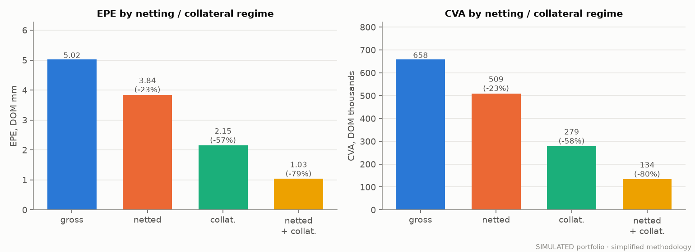

FVA is the same for the gross and netted regimes. That is not a bug. With equal borrowing and lending spreads,
FCA - FBA = $s \sum \mathbb{E}[D\,V]\,\Delta t$, which depends only on the *sum* of trade values and not on how
they are netted. FCA alone *is* lower when netted. See [ANALYSIS.md](ANALYSIS.md#fva).

### CSA terms

<!-- BEGIN:csa_variants -->
| CSA variant (netted) | EPE (mm) | Peak PFE 95% (mm) | Peak PFE 99% (mm) | CVA (k) |
|---|---:|---:|---:|---:|
| Base two-way CSA | 1.03 | 9.86 | 13.14 | 134.1 |
| One-way CSA (only counterparty posts) | 1.01 | 8.84 | 12.45 | 131.4 |
| Base + 5mm independent amount received | 0.01 | 4.86 | 8.14 | 0.6 |
| Idealised: TH = MTA = MPoR = 0 | 0.00 | 0.00 | 0.00 | 0.0 |
<!-- END:csa_variants -->

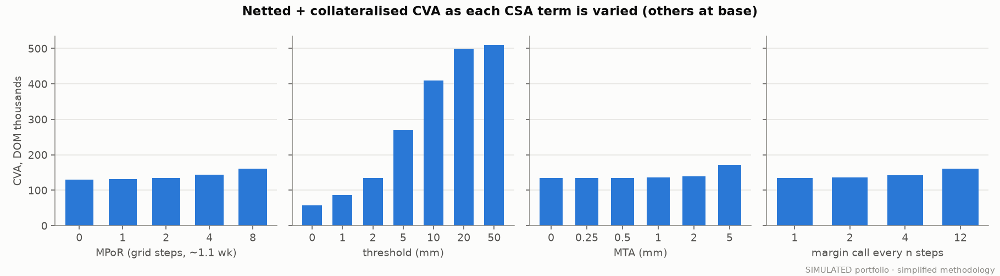

The threshold dominates. Moving it from 0 to 5mm raises CVA from
<!--v:d.sweep_cpty_threshold_mm_0_cva|k-->56.9<!--/v-->k to <!--v:d.sweep_cpty_threshold_mm_5_cva|k-->271.0<!--/v-->k.
Across the whole swept ranges, MTA (0-5mm), margin frequency (1-12 steps) and MPoR (0-8 steps) each move it by
at most about 30%. Full sweep tables are in [ANALYSIS.md](ANALYSIS.md#csa-sweeps).

### CVA sensitivity

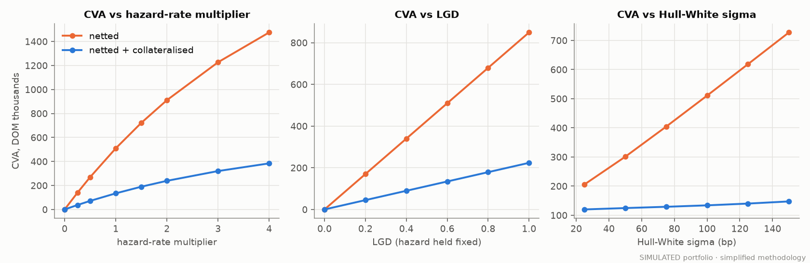

CVA is exactly proportional to LGD (with hazard rates held fixed) and rises steadily, but less than
proportionally, with the hazard rate. It rises with rate volatility much faster without collateral than with it.

### Wrong-way risk

<!-- BEGIN:wwr -->
| Regime | beta | CVA (k) +/- 1.96 SE | CVA / independent | Peak EE given default (mm) | Peak PFE 99% given default (mm) |
|---|---:|---:|---:|---:|---:|
| netted | -1.00 | 144.8 +/- 0.2 | 0.28x | 1.80 | 18.87 |
| netted | -0.50 | 289.1 +/- 0.9 | 0.57x | 3.47 | 23.49 |
| netted | -0.25 | 390.5 +/- 1.9 | 0.77x | 4.65 | 25.79 |
| netted | +0.00 | 509.4 +/- 3.4 | 1.00x | 6.05 | 28.23 |
| netted | +0.25 | 641.9 +/- 5.7 | 1.26x | 7.60 | 30.09 |
| netted | +0.50 | 782.7 +/- 8.8 | 1.54x | 9.23 | 31.86 |
| netted | +0.75 | 925.5 +/- 12.3 | 1.82x | 10.88 | 33.32 |
| netted | +1.00 | 1,063.6 +/- 16.0 | 2.09x | 12.48 | 34.33 |
| netted_collateralised | -1.00 | 37.1 +/- 0.1 | 0.28x | 0.62 | 8.41 |
| netted_collateralised | -0.50 | 77.1 +/- 0.1 | 0.58x | 1.48 | 10.94 |
| netted_collateralised | -0.25 | 104.0 +/- 0.1 | 0.78x | 2.08 | 12.02 |
| netted_collateralised | +0.00 | 134.1 +/- 0.2 | 1.00x | 2.78 | 13.14 |
| netted_collateralised | +0.25 | 165.8 +/- 0.2 | 1.24x | 3.56 | 14.04 |
| netted_collateralised | +0.50 | 197.5 +/- 0.3 | 1.47x | 4.40 | 14.72 |
| netted_collateralised | +0.75 | 227.9 +/- 0.4 | 1.70x | 5.28 | 15.53 |
| netted_collateralised | +1.00 | 255.9 +/- 0.5 | 1.91x | 6.17 | 16.42 |
<!-- END:wwr -->

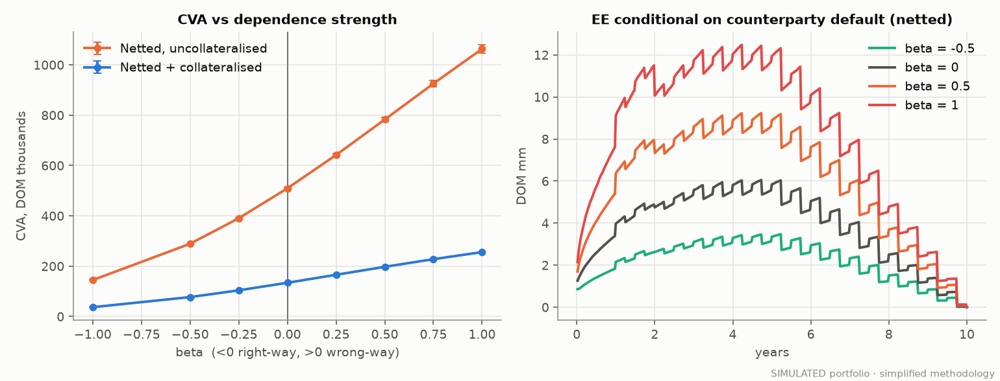

### Monte Carlo convergence, diagnostics and runtime

<!-- BEGIN:convergence -->
| Paths | Antithetic | CVA (k) | Std. error (k) | 95% CI (k) | EPE (mm) | Runtime (s) |
|---:|:---:|---:|---:|---:|---:|---:|
| 500 | yes | 516.5 | 10.7 | [495.6, 537.5] | 3.90 | 0.23 |
| 500 | no | 534.9 | 21.4 | [493.0, 576.7] | 4.02 | 0.26 |
| 1,000 | yes | 502.8 | 7.4 | [488.3, 517.3] | 3.78 | 0.32 |
| 1,000 | no | 516.6 | 15.8 | [485.6, 547.6] | 3.91 | 0.29 |
| 2,000 | yes | 506.6 | 5.6 | [495.6, 517.6] | 3.82 | 0.44 |
| 2,000 | no | 516.1 | 11.0 | [494.5, 537.7] | 3.89 | 0.48 |
| 4,000 | yes | 508.3 | 3.9 | [500.6, 516.0] | 3.83 | 0.79 |
| 4,000 | no | 514.4 | 7.8 | [499.0, 529.8] | 3.88 | 0.77 |
| 8,000 | yes | 508.6 | 2.7 | [503.3, 514.0] | 3.83 | 1.44 |
| 8,000 | no | 515.3 | 5.5 | [504.4, 526.2] | 3.89 | 1.48 |
| 16,000 | yes | 509.6 | 2.0 | [505.8, 513.5] | 3.84 | 3.44 |
| 16,000 | no | 514.1 | 3.9 | [506.4, 521.8] | 3.87 | 3.83 |
| 32,000 | yes | 509.0 | 1.4 | [506.3, 511.7] | 3.84 | 13.88 |
| 32,000 | no | 513.6 | 2.8 | [508.1, 519.0] | 3.87 | 10.85 |
<!-- END:convergence -->

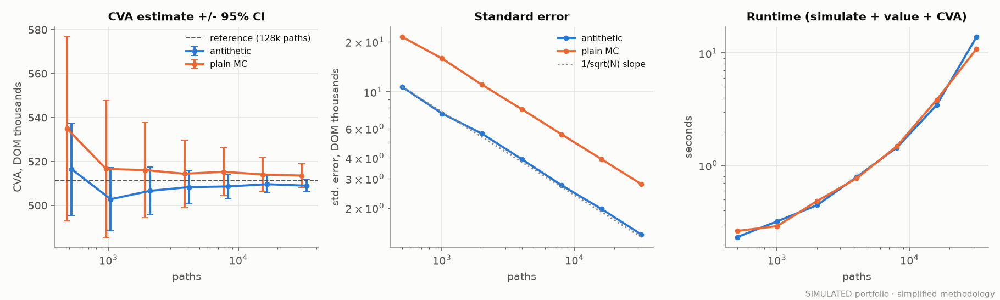

<!-- BEGIN:diagnostics -->
| Check | Result |
|---|---|
| max relative error of E[D(0,t)] vs P(0,t) over all dates | 8.0e-05 (max abs z-score 1.84) |
| FX forward deflated-value martingale error at 1y | 541 DOM on 44.00mm notional (z = 0.18) |
| Par forward-start swap MtM today | 0.00 DOM |
| Variance reduction (plain / antithetic variance, CVA, 32,000 paths) | 4.02x |
| Variance reduction (EPE) | 3.56x |
| Seed replication: 40 seeds x 2,000 paths - empirical std of CVA vs mean reported SE | 5.4k vs 5.5k |
| Seed replication: share of 95% CIs covering the 128,000-path reference | 92.5% |
| Reference netted CVA (128,000 paths) | 511.3k +/- 1.4k |
<!-- END:diagnostics -->

<!-- BEGIN:runtime -->
| Stage (base run, 20,000 paths x 481 dates x 6 trades) | Seconds |
|---|---:|
| Scenario simulation (rates, discount factors, FX) | 0.36 |
| Re-valuation of all trades on all paths and dates | 3.57 |
| Netting, 7 CSA simulations (6 per-trade + 1 netted), exposure stats, PFE bootstrap CIs, XVA for 4 regimes | 7.96 |
| Whole experiment (all sweeps, WWR, convergence) | 223.64 |
<!-- END:runtime -->

Runtimes depend on the machine. The table above is from the machine recorded in `results/summary.json`
(pure NumPy, single process).

---

## Part 4 - How the engine is validated

`python -m pytest` runs 36 tests ([`tests/`](tests)). Highlights:

| Check | How |
|---|---|
| Zero hazard rate gives CVA = 0 | exact |
| Zero exposure gives CVA = 0 | zero-notional swap, exact |
| Zero LGD gives CVA = 0, and CVA is linear in LGD | exact |
| CVA increases with hazard rate and LGD | sweep, strictly increasing |
| **Independent deterministic fixture** | with all volatilities zero, swap values match a separate forward-curve valuation to 1e-9. FX-forward CVA matches the closed form $LGD\cdot V_0\,(1-e^{-\lambda t})$ |
| Collateral does not increase exposure (controlled fixture) | one-way CSA: collateralised PE <= uncollateralised PE on **every path and date**, for three CSA settings |
| Two-way CSA | EPE falls, *and* a test shows that collateral we posted can create exposure (the cashflow-date effect) |
| Perfect CSA / infinite threshold | TH = MTA = MPoR = 0 gives zero exposure. TH = infinity gives back the uncollateralised result |
| MTA, settlement lag, IA, MPoR | no transfer is smaller than the MTA. The lag shifts the balance exactly. IA lowers exposure. Exposure rises with MPoR |
| Netting identities | gross PE >= netted PE pathwise. PE + NE = V in both regimes. Same-sign trades: netted = gross |
| Martingale tests | $\mathbb{E}[D(0,t)] = P(0,t)$, $\mathbb{E}[D\,P(t,T)] = P(0,T)$, and the discounted FX forward value is constant, all within 4 standard errors |
| PFE quantile consistency | PFE90 <= PFE95 <= PFE99. Matches the lognormal closed form within 3%. Exceedance frequency matches 1 - q |
| Monte Carlo convergence | standard error shrinks like $1/\sqrt{N}$. Estimates agree with a 40k-path reference |
| Antithetic variates | lower standard error than plain MC. Pairs are exact mirrors |
| Wrong-way risk | calibration keeps marginal PDs to 1e-14. beta = 0 reproduces independent CVA. beta > 0 raises CVA and beta < 0 lowers it |

---

## Repository layout

```
src/xva/
  curves.py        Nelson-Siegel / flat initial curves (synthetic)
  hull_white.py    Hull-White 1F: bond formula, exact (x, int x) transition
  simulation.py    time grid, joint rates/discount/FX simulation, antithetic pairing
  instruments.py   vanilla IRS (fixed vs float, forward-start), FX forward
  credit.py        piecewise-constant hazard curves, survival, PD, credit-triangle bootstrap
  collateral.py    CSA: threshold, MTA, IA, margin frequency, MPoR, settlement lag
  exposure.py      EE, ENE, PFE, EPE, EEPE; gross vs netted aggregation
  xva.py           CVA (unilateral + first-to-default), DVA, FCA/FBA/FVA with standard errors
  wwr.py           exposure-linked stochastic hazard, calibrated to the CDS curve
  stats.py         pair-aware standard errors, bootstrap quantile CIs
  config.py        the SIMULATED portfolio and market
  experiment.py    end-to-end experiment -> results/
  figures.py       all figures -> figures/
  report.py        writes result tables into the docs and reconciles them
tests/             36 tests (limiting cases, identities, fixtures, convergence)
results/           summary.json, csv tables, profiles.npz
figures/           13 PNG figures
run_all.py         one-command pipeline
```

Further reading in this repo: [ANALYSIS.md](ANALYSIS.md) (what the results mean),
[MODEL_ASSUMPTIONS.md](MODEL_ASSUMPTIONS.md) (every simplification),
[RESUME_BULLETS.md](RESUME_BULLETS.md).

## Glossary

| Term | Meaning |
|---|---|
| **MtM** | mark-to-market: the current value of a trade |
| **Netting set** | all trades with one counterparty under one netting agreement |
| **CSA** | Credit Support Annex: the collateral terms |
| **VM / IM / IA** | variation margin (follows the MtM), initial margin, independent amount (a static IM) |
| **MPoR** | margin period of risk: the gap between the last collateral received and close-out |
| **Hazard rate** | instantaneous default intensity: roughly the default probability per year |
| **LGD** | loss given default = 1 - recovery rate |
| **CVA / DVA / FVA** | credit, debit and funding valuation adjustments |
| **WWR** | wrong-way risk: exposure is high when default is likely |
| **Antithetic variates** | pairing each random path with its mirror image to reduce noise |

## License

MIT. See [LICENSE](LICENSE).
